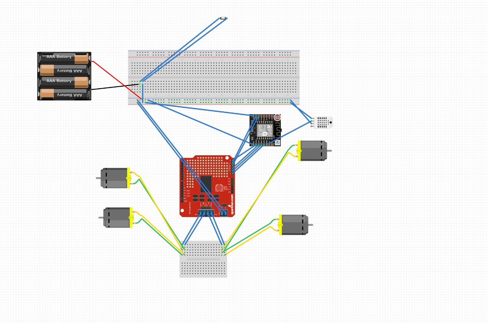
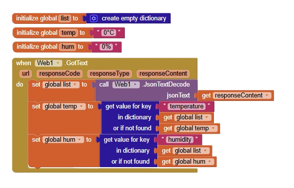

# Temperature Autobot

A WiFi robot car built on an ESP8266 that also reports temperature and humidity. The ESP8266 creates its own WiFi access point and runs a small web server. An Android app, built with MIT App Inventor, connects to it, sends driving commands and shows the sensor readings.

## Hardware

- ESP8266 board
- DHT11 temperature and humidity sensor
- L298N dual motor driver
- Two DC motors on a chassis
- Battery pack, breadboard, jumper wires

| Top view | Breadboard | Motors |
|---|---|---|
|  |  |  |

## How it works

The ESP8266 sketch (`esp-code.ino`) starts in access point mode and listens on port 80. The app sends driving commands (forward, backward, left, right, stop) to `/` and the sketch sets the L298N pins accordingly. `GET /temperature` reads the DHT11 and returns `{"temperature": ..., "humidity": ...}`, which the app displays.

The app logic is made with App Inventor blocks:

| Forward | Backward | Left | Right | Stop |
|---|---|---|---|---|
|  |  |  |  |  |

Reading and parsing the sensor JSON:

## Files

| File | What it is |
|---|---|
| `esp-code.ino` | Arduino sketch for the ESP8266 |
| `android-app.apk` | Ready-to-install Android app |
| `app-project.aia` | App Inventor source, which you can import at [ai2.appinventor.mit.edu](https://ai2.appinventor.mit.edu) |

## Setup

1. Install the ESP8266 board package and the DHT sensor library in the Arduino IDE.
2. Set the access point name and password at the top of `esp-code.ino` and upload it.
3. Install `android-app.apk` on your phone, connect to the robot's WiFi network and open the app.
